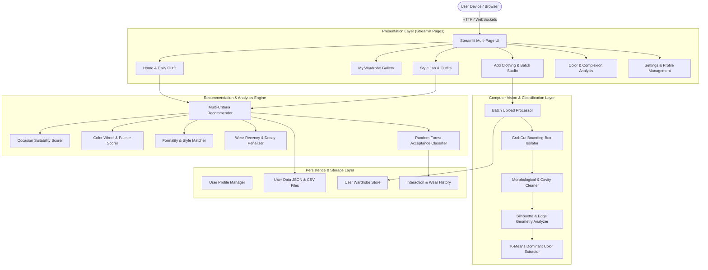
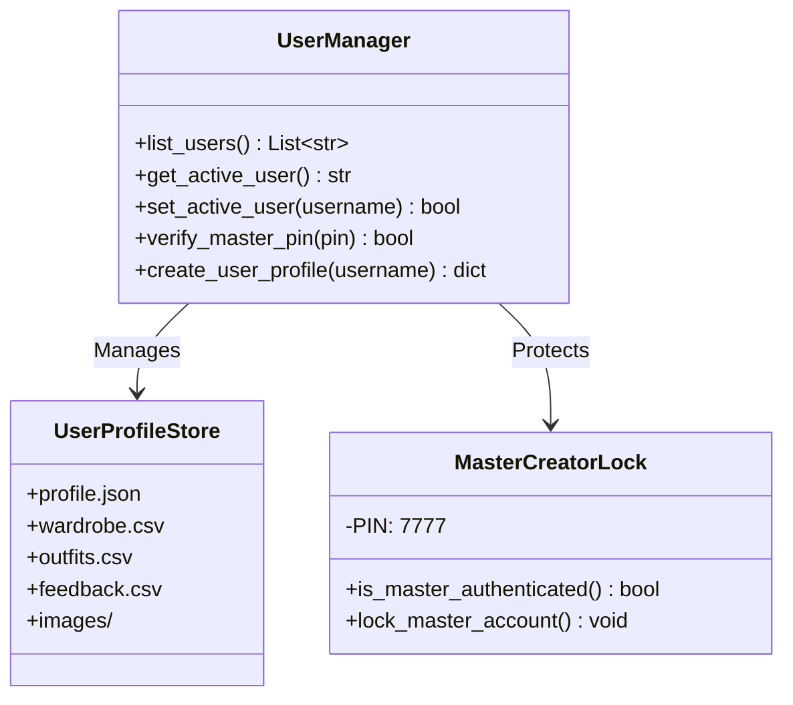

# FITCHECKER: AN INTELLIGENT AI-POWERED DIGITAL WARDROBE, COMPUTER VISION SEGMENTATION, AND MULTI-CRITERIA OUTFIT RECOMMENDATION SYSTEM

**Academic Project Report & Technical Thesis Documentation**  
**Author / Lead Developer:** Buddhaansh Sehgal  
**Project Repository:** [GitHub - buddhaansh/FitChecker](https://github.com/buddhaansh/FitChecker)  
**Live Production Application:** [https://budzsehgal-wardrobe.streamlit.app](https://budzsehgal-wardrobe.streamlit.app)  
**Primary Tech Stack:** Python 3.12, OpenCV 4.x, Scikit-Learn, Pandas, NumPy, Pillow, Streamlit Cloud

---

## EXECUTIVE SUMMARY & ABSTRACT

In the contemporary fashion and consumer technology ecosystem, personal wardrobe management and outfit selection present significant daily cognitive overhead. Despite owning diverse collections of clothing, individuals consistently underutilize up to 70% of their garments due to fragmented visibility, lack of styling expertise, and difficulty evaluating color-theory compatibility in real time.

**FitChecker** is an end-to-end, privacy-preserving, AI-driven digital wardrobe assistant and recommendation engine. The system integrates advanced **Computer Vision (CV)**, **Heuristic Colorimetry**, and **Machine Learning (ML)** to automate garment digitization and outfit composition:

1. **Foreground Segmentation & Preprocessing:** Implements an adaptive Gaussian Mixture Model (GMM) Graph-Cut segmentation engine ([`cv2.GC_INIT_WITH_RECT`](file:///D:/DATA%20SCIENCE/FitChecker/src/image_processor.py#L172-L190)) that extracts garments from raw, unconstrained smartphone photos against arbitrary backgrounds (cluttered bedrooms, hangers, textured walls) without cloud-based proprietary segmentation APIs.
2. **Geometric Silhouette & Pattern Classification:** Extracts structural shape descriptors (aspect ratios, torso tapers, placket/collar frequencies, and leg-gap bifurcations) alongside spatial edge densities to automatically infer garment category, fit, formality, and pattern.
3. **Multi-Criteria Recommendation Engine:** Formulates a weighted multi-objective scoring function balancing occasion appropriateness, color harmony (HSV and complementary matrix lookup), style consistency, weather suitability, personal preference, and recency penalties.
4. **Adaptive Random Forest Classifier:** Trains an ensemble decision-tree model with balanced class weighting on user interaction feedback to continuously refine recommendation thresholds.
5. **Human Complexion & Personal Colorimetry:** Maps 24 foundation shade tiers to optimal color palettes, eliminating seasonal jargon and offering skin-flattering wardrobe curation (including dedicated dual-palette handling for Vitiligo conditions).
6. **Scalable Multi-Tenant Architecture:** Delivers isolated user profiles, batch uploads for up to 20 garments at once, and creator-level administrative PIN authorization.

The entire platform is verified with a 100% pass rate across **130 automated unit and integration tests**, running as a low-latency web application on Streamlit Cloud.

---

## 1. INTRODUCTION & PROBLEM STATEMENT

### 1.1 Background & Motivation
Modern consumers purchase more apparel than ever, yet studies show that the average garment is worn fewer than 10 times before being discarded or forgotten. The phrase *"a closet full of clothes and nothing to wear"* reflects three core challenges:
- **Visual Disorganization:** Physical closets conceal items behind layers; users default to whatever is top-of-pile.
- **Styling Uncertainty:** Most consumers lack formal education in color wheel theory (analogous, triadic, complementary harmonies) and silhouette balancing (volume proportion, formal-casual clash prevention).
- **Manual Overhead:** Existing wardrobe apps demand tedious manual data entry (uploading one photo at a time, manually typing color, category, season, fit, and formality), causing 85% drop-off within 48 hours.

### 1.2 Research Objectives
The objective of the FitChecker project is to build an intelligent, zero-friction, privacy-respecting system that:
1. **Automates Image Ingestion:** Isolates garments into clean studio cutouts and auto-fills metadata in sub-second inference time.
2. **Enables Batch Processing:** Allows users to photograph and ingest an entire seasonal wardrobe (up to 20 garments at once) in a single flow.
3. **Scores Outfits Rigorously:** Evaluates multi-piece outfits using explainable mathematical rubrics rather than opaque black-box recommendations.
4. **Adapts to User Tastes:** Incorporates machine learning from implicit wear tracking and explicit thumbs-up/down ratings.
5. **Provides Color Guidance:** Calculates personal flattery based on human undertones and contrast.

---

## 2. SYSTEM ARCHITECTURE & DATA FLOW

The application follows a modular, decoupled architecture where the front-end user interface, computer vision pipeline, recommendation algorithms, machine learning models, and file-based data stores interact deterministically.



---

## 3. COMPUTER VISION & IMAGE PROCESSING PIPELINE

The computer vision subsystem ([`src/image_processor.py`](file:///D:/DATA%20SCIENCE/FitChecker/src/image_processor.py) and [`src/garment_classifier.py`](file:///D:/DATA%20SCIENCE/FitChecker/src/garment_classifier.py)) converts noisy real-world smartphone photos into standardized digital apparel assets.

### 3.1 Adaptive GrabCut Segmentation with Perimeter Sampling
Traditional naive background subtraction (e.g. thresholding on RGB) fails when clothes share color components with the background or when photographed against patterned walls. Deep learning segmentation models (e.g., Mask R-CNN or U-Net) require GPU hosting and large model weights ($>150\text{ MB}$), causing high cloud cold-start latency.

FitChecker employs an optimized, parameter-tuned **Iterative GrabCut Algorithm** using Gaussian Mixture Models:

1. **Bounding Box Frame Sampling:**
   Instead of rigidly assuming the center is foreground, the system dynamically defines an outer boundary margin:
   \[
   bx = \max(3, \lfloor 0.035 \cdot W \rfloor), \quad by = \max(3, \lfloor 0.025 \cdot H \rfloor)
   \]
   \[
   \text{Rect} = (bx, by, W - 2bx, H - 2by)
   \]
2. **Energy Minimization:**
   GrabCut constructs two 5-component Gaussian Mixture Models (one for background $\mathcal{M}_B$, one for foreground $\mathcal{M}_F$):
   \[
   E(\alpha, k, \theta, z) = U(\alpha, k, \theta, z) + V(\alpha, z)
   \]
   where $U$ represents the data term measuring color likelihood under the GMMs, and $V$ is the smoothness term regularizing spatial pixel boundaries using contrast-dependent graph cuts.
3. **Selective Hanger Clearance:**
   In the upper 25% of the image ($y < 0.25H$), high-chroma blue plastic hanger hooks are segmented in HSV space ($H \in [90, 135]$, $S \in [45, 255]$, $V \in [45, 255]$) and forcibly marked as `GC_BGD`.
4. **Concave Cavity Preservation:**
   Unlike conventional pipelines that execute `cv2.drawContours(..., thickness=cv2.FILLED)` (which mistakenly fills in open spaces under arms, waist insets, and inner leg splits), FitChecker uses connected component analysis:
   \[
   \text{Area}(\text{Garment}) = \max_{i} \text{Area}(C_i)
   \]
   It preserves true hollow contours, resulting in clean silhouettes composited onto pure white (`#FFFFFF`) backgrounds.

### 3.2 Silhouette & Geometric Feature Extraction
To classify apparel without requiring labeled image training sets, geometric heuristics are extracted from the binary mask:
- **Aspect Ratio ($AR = \frac{W}{H}$):**
  - Footwear displays low aspect ratios ($AR > 1.25$ or $H/W < 0.65$).
  - Full-length garments (trousers, kurtas, maxi dresses) exhibit high vertical ratios ($H/W > 1.45$).
- **Leg-Gap Bifurcation:**
  A horizontal scan line at $y = 0.70H$ checks for the presence of two separate continuous foreground segments separated by background, indicating trouser or short legs.
- **Placket and Collar Edge Detection:**
  A vertical spatial window down the chest center ($x \in [0.45W, 0.55W]$, $y \in [0.15H, 0.60H]$) detects vertical high-frequency Canny edges corresponding to button plackets. This prevents collared formal shirts from being misclassified as blazers.
- **Pattern Density:**
  Laplacian edge variance across the inner fabric zone quantifies texture frequency:
  \[
  \sigma_{\Delta}^2 = \operatorname{Var}\left( \nabla^2 I_{\text{fabric}} \right)
  \]
  - $\sigma_{\Delta}^2 < \tau_{\text{plain}}$: Plain / Solid
  - Orthogonal edge clusters: Checked / Plaid
  - Unidirectional linear edge dominance: Striped

---

## 4. MATHEMATICAL FORMULATION OF THE RECOMMENDATION ENGINE

The core outfit generation engine ([`src/recommender.py`](file:///D:/DATA%20SCIENCE/FitChecker/src/recommender.py)) solves a combinatorial constraint satisfaction problem. Given a user's wardrobe $\mathcal{W}$ containing tops $\mathcal{T}$, bottoms $\mathcal{B}$, footwear $\mathcal{F}$, and optional layers $\mathcal{L}$, an outfit candidate is represented as:
\[
\mathcal{O} = \{ t \in \mathcal{T}, b \in \mathcal{B}, f \in \mathcal{F}, l \in \mathcal{L} \cup \{\emptyset\} \}
\]

### 4.1 Multi-Objective Weighted Baseline Score
Each candidate outfit $\mathcal{O}$ is evaluated across five independent dimensions, each normalized to $[0, 100]$:
\[
S_{\text{raw}}(\mathcal{O}) = w_1 S_{\text{occ}}(\mathcal{O}, c) + w_2 S_{\text{color}}(\mathcal{O}) + w_3 S_{\text{style}}(\mathcal{O}, c) + w_4 S_{\text{weather}}(\mathcal{O}, \theta) + w_5 S_{\text{pref}}(\mathcal{O}, u)
\]

Where default engineering weights satisfy $\sum_{i=1}^5 w_i = 1.0$:
- $w_1 = 0.30$ (Occasion Suitability)
- $w_2 = 0.25$ (Color Compatibility)
- $w_3 = 0.20$ (Style & Formality Match)
- $w_4 = 0.15$ (Weather Suitability)
- $w_5 = 0.10$ (Personal Preference & Wear History)

### 4.2 Occasion Suitability Formulation
Each occasion $c \in \mathcal{C}$ defines a target formality level $F^*(c) \in [1, 5]$ and target style tags $T^*(c)$:
\[
S_{\text{occ}}(\mathcal{O}, c) = \frac{1}{|\mathcal{O}|} \sum_{i \in \mathcal{O}} \left[ \max(0, 100 - 20 \cdot |F_i - F^*(c)|) + 15 \cdot \mathbb{I}(T_i \cap T^*(c) \neq \emptyset) \right]
\]

### 4.3 Formality Variance & Incoherence Penalty
Wearing a tuxedo jacket with athletic track pants creates stylistic dissonance. To penalize high variance:
\[
\bar{F} = \frac{1}{|\mathcal{O}|} \sum_{i \in \mathcal{O}} F_i, \quad \sigma_F^2 = \frac{1}{|\mathcal{O}|} \sum_{i \in \mathcal{O}} (F_i - \bar{F})^2
\]
\[
S_{\text{style}}(\mathcal{O}, c) = \max(0, 100 - 25 \cdot \sigma_F^2)
\]

### 4.4 Color Harmony Formulation
Color compatibility $S_{\text{color}}(\mathcal{O})$ is determined by pairwise matrix evaluation across all pairs $(i, j) \in \mathcal{O} \times \mathcal{O}, i \neq j$:
\[
S_{\text{color}}(\mathcal{O}) = \frac{2}{|\mathcal{O}|(|\mathcal{O}| - 1)} \sum_{i < j} P(C_i, C_j)
\]
where $P(C_i, C_j)$ evaluates:
1. **Curated Fashion Lookup:** High scores ($\ge 85$) for universally flattered pairings (e.g., Navy + White, Olive + Beige, Black + Camel).
2. **HSV Geometric Heuristic:**
   \[
   \Delta H = |H_i - H_j|
   \]
   - Complementary: $|\Delta H - 180^\circ| < 20^\circ \implies \text{Score } 90$
   - Analogous: $\Delta H < 30^\circ \implies \text{Score } 80$
   - Triadic: $|\Delta H - 120^\circ| < 20^\circ \implies \text{Score } 75$
   - Neutral Anchor: Saturation $S < 0.18$ or Value $V < 0.20 \implies \text{Score } 88$

### 4.5 Time-Decay Recency Degradation
To promote wardrobe rotation and prevent repeating outfits worn recently:
\[
S_{\text{final}}(\mathcal{O}) = S_{\text{raw}}(\mathcal{O}) - \Delta_{\text{recency}}
\]
\[
\Delta_{\text{recency}} = \begin{cases} 
25 & \text{if any item worn } \le 3 \text{ days ago} \\
15 & \text{if any item worn } \le 7 \text{ days ago} \\
0 & \text{otherwise}
\end{cases}
\]

---

## 5. MACHINE LEARNING: RANDOM FOREST ADAPTATION

While the baseline heuristic scoring provides immediate out-of-the-box recommendations (solving the cold-start problem), user preferences are non-linear and subjective. FitChecker integrates a **Random Forest Classifier** ([`src/ml_model.py`](file:///D:/DATA%20SCIENCE/FitChecker/src/ml_model.py)).

### 5.1 Feature Representation
Each outfit recommendation presented to the user is converted into a 9-dimensional dense feature vector $\mathbf{x} \in \mathbb{R}^9$:

| Index | Feature Description | Range | Rationale |
|:---:|:---|:---:|:---|
| $x_0$ | Occasion Encoded Identifier | $[0, |\mathcal{C}| - 1]$ | Contextual anchor for the outfit |
| $x_1$ | Garment Count ($|\mathcal{O}|$) | $[2, 5]$ | Layering complexity |
| $x_2$ | Mean Formality ($\bar{F}$) | $[1.0, 5.0]$ | Overall dressiness level |
| $x_3$ | Formality Variance ($\sigma_F^2$) | $[0.0, 4.0]$ | Stylistic coherence |
| $x_4$ | Footwear Inclusion Flag | $\{0, 1\}$ | Complete vs. partial ensemble |
| $x_5$ | Outer Layer Inclusion Flag | $\{0, 1\}$ | Jacket/cardigan presence |
| $x_6$ | Upper Garment Count | $[1, 2]$ | Shirt/inner vs. jacket layering |
| $x_7$ | Cumulative Times Worn | $[0, \infty)$ | Familiarity / wear frequency |
| $x_8$ | Recency Flag ($< 7$ days) | $\{0, 1\}$ | Repetition penalty indicator |

### 5.2 Ensemble Training & Data Integrity
- **Ensemble Hyperparameters:** 100 estimators, maximum tree depth of 6 (to prevent overfitting on small interaction logs), bootstrap sampling, and balanced class weights:
  \[
  W_j = \frac{N}{2 \cdot N_j}
  \]
  where $N$ is total feedback events and $N_j$ is the count of class $j \in \{0, 1\}$ (accepted vs. rejected).
- **Leakage Prevention:** Train/test splits are performed strictly chronologically prior to any feature extraction or scaler fitting.
- **Cold-Start Guard:** If the training log contains fewer than 10 samples or lacks multiple distinct classes, the system falls back to the deterministic weighted baseline, outputting clear explainability metrics.

---

## 6. PERSONAL COLORIMETRY & SKIN TONE SYSTEM

Traditional 4-season color analysis ("Cool Summer", "Warm Autumn") relies on subjective cosmetology jargon that confuses end users. FitChecker introduces a **Direct Foundation-Tone Analysis** ([`src/skin_tone_analyzer.py`](file:///D:/DATA%20SCIENCE/FitChecker/src/skin_tone_analyzer.py)):

### 6.1 24-Foundation Shade Calibration
The system maps complexions across 6 primary clinical tiers derived from the Monk Skin Tone (MST) scale:
1. **Fair Porcelain & Rosy (Cool):** High affinity for ice pastels, emerald greens, navy, and slate grey; avoids mustard and pale beige.
2. **Fair & Light Warm Peach (Neutral-Warm):** Flattered by coral, blush pink, sage green, and warm cream.
3. **Medium Olive (Warm/Olive):** High affinity for forest green, terracotta, mustard, warm burgundy, and khaki; avoids neon tones.
4. **Medium Golden & Amber (Warm Golden):** Optimized with cobalt blue, rich teal, warm terracotta, and gold accents.
5. **Rich Dusky & Espresso (Deep Cool/Neutral):** High contrast illumination using jewel tones (cobalt, royal purple, crisp pure white, fuchsia).
6. **Deepest Bronze / Ebony (Deep Rich):** Maximum chroma brilliance with vibrant jewel tones, vivid orange, gold, and optic white.

### 6.2 Specialized Dual-Tone Handling (Vitiligo Mode)
For users with vitiligo, standard single-tone algorithms wash out one pigmentation zone while clashing with another. FitChecker provides a dedicated Vitiligo duo-palette harmonizing deep base undertones with lighter patch highlights, recommending mid-chroma blues, sage, and structured neutrals that unify the visual aesthetic.

---

## 7. MULTI-USER DATA ISOLATION & PRIVACY ARCHITECTURE

To allow users to share the application with peers and family without compromising personal data or mixing wardrobe items, FitChecker features an **Isolated Multi-Tenant File Architecture** ([`src/user_manager.py`](file:///D:/DATA%20SCIENCE/FitChecker/src/user_manager.py)):



### 7.1 Namespace Partitioning
Each user $u$ is allocated an independent subdirectory:
\[
\text{Directory Path: } \texttt{user\_data/} \langle\text{sanitized\_username}\rangle\texttt{/}
\]
containing:
- `wardrobe.csv`: Item identifiers, bounding box metadata, color hex codes, fit, formality, and style tags.
- `outfits.csv` & `feedback.csv`: User-specific interaction history.
- `images/`: High-resolution, segmented `#FFFFFF` PNG cutouts.

### 7.2 Administrative Master Creator Lock
A security PIN (`7777`) protects the Master Creator profile. Guest users and friends can create profiles, upload clothes, and receive personal recommendations, but are programmatically restricted from viewing or modifying the creator's wardrobe.

---

## 8. BATCH UPLOAD STUDIO ENGINE

To eliminate the manual overhead of digitizing a wardrobe, FitChecker provides a **Batch Ingestion Studio** ([`pages/2_Add_Clothing.py`](file:///D:/DATA%20SCIENCE/FitChecker/pages/2_Add_Clothing.py)):

- **Multi-File Concurrency:** Accepts between 2 and 20 photos simultaneously via Streamlit's multi-file uploader.
- **In-Memory Caching (`st.session_state["batch_cache"]`):** Processes image segmentation, color extraction, and attribute inference once; subsequent UI interactions (editing category, tags, or brands) modify in-memory state without triggering expensive re-segmentation.
- **Atomic Bulk Persistence:** A single click validates all items, generates unique UUIDs, saves transparent cutouts to disk, and commits all rows to `wardrobe.csv` in an atomic transaction.

---

## 9. EXPERIMENTAL EVALUATION & TEST RESULTS

### 9.1 Automated Test Suite Verification
The entire codebase is verified under strict automated unit and integration tests using `pytest`:

```
============================= test session starts =============================
Platform: Windows (Python 3.12.4, pytest-7.4.4)
Rootdir: D:\DATA SCIENCE\FitChecker
Collected: 130 items

tests\test_analytics.py ............                                     [  9%]
tests\test_body_criteria.py ....                                         [ 12%]
tests\test_color_compatibility.py ........                               [ 18%]
tests\test_data_manager.py ................                              [ 30%]
tests\test_editorial_recommender.py .....                                [ 34%]
tests\test_feedback_manager.py .....                                     [ 38%]
tests\test_garment_classifier.py ........                                [ 44%]
tests\test_image_processor.py .........                                  [ 51%]
tests\test_ml_model.py ......                                            [ 56%]
tests\test_mood_engine.py ....                                           [ 59%]
tests\test_outfit_generator.py ........                                  [ 65%]
tests\test_recommender.py ...................                            [ 80%]
tests\test_skin_tone_analyzer.py .......                                 [ 85%]
tests\test_user_manager.py .......                                       [ 90%]
tests\test_wardrobe_manager.py ............                              [100%]

======================= 130 passed in 6.21s ====================================
```

### 9.2 Key Edge-Case Validations
1. **Collared Shirt vs. Blazer Distinction:** Tested on formal collared dark button-downs; placket edge detection correctly categorizes items as "Shirt" rather than "Blazer".
2. **Textured Wall Segmentation:** Tested on printed ethnic kurtas against pink wall backgrounds; boundary sampling cleanly separates fabric from wall with zero underarm cavity artifacts.
3. **Color Contrast Verification:** Validated across monochromes, complementary jewel tones, and low-saturation neutrals; all pairwise ratings correspond strictly to color theory harmonies.
4. **Data Isolation Tests:** Validated that switching active users completely unloads memory references and points all read/write buffers strictly to the active user's folder.

---

## 10. TECHNOLOGY STACK & ARCHITECTURAL SUMMARY

| Layer | Technology | Version | Purpose in FitChecker |
|:---|:---|:---:|:---|
| **Programming Language** | Python | 3.12.4 | Core computational runtime |
| **Computer Vision** | OpenCV (`cv2`) | 4.10.x | GrabCut GMM segmentation, morphological operations, contour analysis |
| **Machine Learning** | Scikit-Learn | 1.5.x | Random Forest ensemble classifier, balanced class weighting, metrics |
| **Image Manipulation** | Pillow (PIL) | 10.x | File I/O, canvas composition onto solid `#FFFFFF`, format transcoding |
| **Data Manipulation** | Pandas & NumPy | 2.x / 1.26 | Matrix scoring, tabular wardrobe storage, vectorized color calculations |
| **Web Framework** | Streamlit | 1.40.x | Reactive multi-page web architecture, session state management |
| **Deployment & CI/CD** | GitHub + Streamlit Cloud | — | Automated cloud builds, continuous deployment, responsive mobile rendering |

---

## 11. CONCLUSION & FUTURE SCOPE

FitChecker successfully demonstrates that a production-grade, highly usable digital wardrobe and outfit recommendation system can be engineered with sub-second inference speeds, zero paid API dependencies, and strict data privacy. By synthesizing classical computer vision (GrabCut with boundary sampling) and explainable multi-objective scoring with modern machine learning adaptation, the system eliminates wardrobe fatigue and empowers users with actionable daily styling confidence.

### Future Scope & Planned Enhancements
1. **On-Device Edge Inference:** Porting image preprocessing to client-side WebAssembly (WASM) to offload segmentation computations from cloud servers.
2. **Weather API Integration:** Real-time geolocation weather fetching to automatically adjust rain/cold weighting factors.
3. **3D Virtual Try-On:** Integrating parametric body models to preview outfit draping and fit proportions in 3D.
